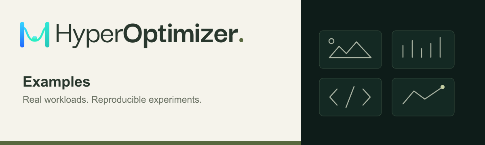

# HyperOptimizer Examples

[](https://github.com/hyperoptimizer/examples/actions/workflows/ci.yml)
[](LICENSE)

Runnable examples for [HyperOptimizer](https://hyperoptimizer.com). Start with a local Docker workload, define the parameters and objective, then launch an optimization experiment.

[Documentation](https://docs.hyperoptimizer.com) · [CLI](https://github.com/hyperoptimizer/cli) · [Python SDK](https://github.com/hyperoptimizer/python-sdk) · [Report an issue](https://github.com/hyperoptimizer/examples/issues)

## Start here: smaller images, measured quality

Find WebP compression settings that reduce file size while meeting an image-quality floor. This example includes a small photo dataset, a Docker workload, a search configuration, and a reproducible local benchmark.


*Original → WebP, using the settings selected by the local benchmark. Photo: Rachel Michetti / Pikolo Espresso Bar, CC0. [Dataset credits](image-compression/dataset/ATTRIBUTION.md).*

| Tune | Measure | Require |
| --- | --- | --- |
| WebP quality (`50–100`) and method (`0–6`) | Encoded file size and structural similarity (SSIM) | Minimum SSIM of `0.95` across the evaluated images |

The objective ranks every configuration that meets the quality floor ahead of every violation, then favors smaller output among passing configurations.

**[Read the walkthrough →](image-compression/README.md)** · [Search configuration](image-compression/hpo.toml) · [Recorded local results](image-compression/evidence/benchmark.json)

## Run your first trial

You'll need Git and Docker. The local trial runs without a HyperOptimizer account or runtime network access; the image build downloads its dependencies.

```sh
git clone https://github.com/hyperoptimizer/examples.git
cd examples

docker build --platform linux/amd64 \
  -t hpo-compression:local image-compression

docker run --rm --platform linux/amd64 \
  --network=none --memory=512m --cpus=1 \
  hpo-compression:local --hpo-quality=80 --hpo-method=4
```

The trial prints metrics such as `hpo.metrics.total_bytes`, `hpo.metrics.minimum_ssim`, and `hpo.metrics.compression_loss`. This baseline is a starting point; check `hpo.metrics.quality_pass` to see whether it meets the quality floor.

### Launch an optimization experiment

Install the [HyperOptimizer CLI](https://github.com/hyperoptimizer/cli#installation), sign in, and choose a project with compute allowance. Building and pushing the workload requires Docker with Buildx.

From the repository root, replace `YOUR_PROJECT_ID` with your project ID:

```sh
hpo login
hpo --config image-compression/hpo.toml optimize \
  --project YOUR_PROJECT_ID --detach
```

The configuration builds and pushes the workload image, then searches quality and method using Bayesian TPE. It specifies 32 trials, one concurrent trial, and seed `42`. Validate one managed trial's runtime and memory requirements before running the full search; see the [walkthrough](image-compression/README.md#managed-optimization).

To reproduce the search locally and export image comparisons, follow the [local benchmark instructions](image-compression/README.md#reproduce-local-search-and-export-comparisons). The committed results come from local execution on a small demonstration dataset.

## Test fixtures

These small workloads exercise integration behavior. Start with image compression for the end-to-end tutorial.

| Fixture | Purpose |
| --- | --- |
| [Normal](fixtures/normal) | A bounded Rosenbrock objective that emits numeric loss metrics |
| [Trial smoke](fixtures/trial-smoke) | A dependency-free Python objective and bounded network probes |
| [Python tracking](fixtures/python-tracking) | Reporting through the public Python SDK; full reporting requires the platform |

See the [fixture instructions](fixtures/README.md) for build contexts and local tests.

## Builds and releases

[CI](https://github.com/hyperoptimizer/examples/actions/workflows/ci.yml) builds all four containers and runs smoke checks with networking disabled, resource limits, and a non-root user. The Python tracking smoke check verifies installation with `--help`; it does not exercise live reporting.

<details>
<summary>Image publishing and reproducibility</summary>

Releases repeat the CI checks before publishing `linux/amd64` images to:

```text
ghcr.io/hyperoptimizer/examples/<name>:<version>
ghcr.io/hyperoptimizer/examples/<name>:sha-<full-commit>
```

Download the digest artifacts from the [release workflow](https://github.com/hyperoptimizer/examples/actions/workflows/release.yml) and pin consumers to `image@sha256:...` rather than mutable tags.

Maintainers must set each GHCR package's visibility to **Public** after its first release and verify anonymous pulls. Public repository visibility does not automatically make its packages public.

The tracking image installs `hyperoptimizer==0.1.0` from PyPI. Public CI does not use a private SDK checkout.

</details>

## License

Code is licensed under [MIT](LICENSE). Bundled photographs retain their individual public-domain or CC0 terms; see the [dataset attribution](image-compression/dataset/ATTRIBUTION.md) and [manifest](image-compression/dataset/manifest.json).
