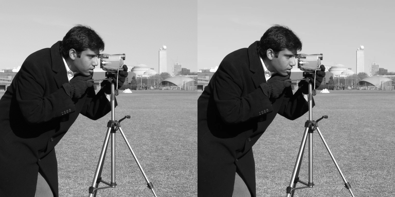

# Find smaller website images that meet a quality target

Status: reviewable draft. These measurements come from local Python execution, not a managed Hyperoptimizer run.

A website team can turn image encoding into a measurable optimization problem: choose WebP settings, encode the same photographs, and compare file sizes while requiring each image to reach SSIM 0.95. SSIM is a proxy, so inspect the output visually too.

## One container, one measurement

The `image-compression` container accepts `--hpo-quality` and `--hpo-method`, uses bundled photos without network access, reports `hpo.metrics.*`, and exits. Quality violations receive a finite penalty; missing data and execution errors fail the run. The objective ranks every passing configuration ahead of every quality violation, then minimizes bytes among passing configurations.

## Reproduce the experiment

Follow [the runnable example](image-compression/README.md). Its hpo.toml builds and pushes the image into your workspace registry and configures 32 Bayesian trials, seed 42, one concurrent trial and a 180-second timeout. Run one trial first to verify Nano resource suitability. Public GHCR publication does not replace the workspace-registry flow on ordinary plans.

The recorded local search uses Optuna 4.5.0 TPE with the same search space and budget. It selected quality 95 and method 3. Dependencies, dataset checksums, all trial parameters, local run ID and per-image metrics are in [the evidence](image-compression/evidence/benchmark.json). The published image digest is recorded as a reproduction reference. This recorded benchmark ran directly in local Python, so its managed run ID and execution-image digest remain absent.

## What actually happened

| Dataset | Configuration | Bytes | Minimum SSIM | Quality passes |
| --- | --- | ---: | ---: | --- |
| tuning | baseline | 60,880 | 0.928551 | False |
| tuning | high_quality_reference | 194,772 | 0.953673 | True |
| tuning | selected | 139,724 | 0.951305 | True |
| holdout | baseline | 17,256 | 0.968280 | True |
| holdout | high_quality_reference | 49,842 | 0.994501 | True |
| holdout | selected | 36,342 | 0.991431 | True |

The default quality-80/method-4 baseline fails the quality floor on tuning images. It is not an acceptable equivalent-quality comparator. A conservative quality-100/method-4 reference passes; the selected settings produce 28.3% fewer bytes on tuning images and 27.1% fewer on the fresh holdout. The holdout output is larger than the default baseline, which already passes on that photograph: one globally selected configuration is not the best setting for every individual image.

## What this does and does not establish

The initial three-photo search failed on a held-out rocket photo. That exploratory result is retained in `image-compression/exploratory-benchmark.json`. We then included those four photos in tuning and introduced a fresh camera photograph as the final holdout. The final holdout was evaluated only after selection; it was not used to retune the selected parameters.

This is a five-photo demonstration, not a promise about all web imagery or proof of a global optimum. Image dimensions and metadata treatment stay fixed; encoding time is diagnostic. Compare original and decoded images visually, and repeat the workflow on a larger representative corpus before shipping a global encoding policy.

SDK and container publication passed CI. Anonymous GHCR pull verification remains incomplete while the remaining package visibility settings are being configured. Managed execution, production memory suitability and platform screenshots remain pending. Add actual run links and image digest only after those checks succeed.
